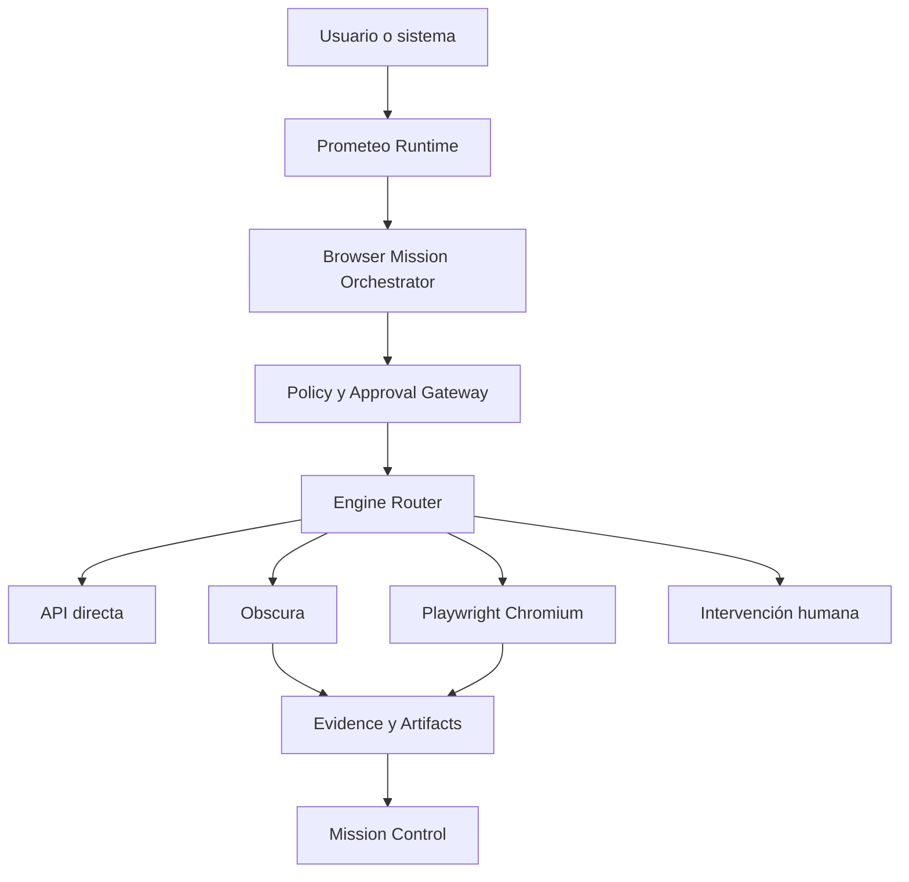

# ADR-022 — SEMSE Browser Agent & Web Operator

**Estado:** PROPOSED  
**Fecha:** 2026-07-14  
**Contexto:** Integración de capacidades de navegación gobernada y multi-motor para SEMSEproject.

## Decisión

SEMSE Browser Agent se implementará como una capacidad del sistema operativo SEMSE, detrás de un gateway de políticas y aprobaciones. El enrutamiento preferirá una API oficial cuando exista, después un motor ligero compatible, y finalmente Playwright o intervención humana según compatibilidad y riesgo.

## Gobernanza y seguridad

- Bloquear SSRF hacia localhost, redes privadas, metadata cloud y esquemas peligrosos.
- Tratar el contenido web como no confiable y filtrarlo antes de entregarlo a modelos.
- Aislar sesiones por misión y tenant; no registrar credenciales en prompts ni logs.
- Requerir aprobación humana para login, formularios, mensajes, pagos, firmas y eliminaciones.
- Capturar evidencias, hashes, timestamps y artefactos con retención y auditoría.

## Componentes previstos

1. Mission Orchestrator y runtime asíncrono.
2. Registry y router de motores.
3. Session Manager, sandbox y Secure Network Gateway.
4. Policy/Approval Gateway y Browser Tool Registry.
5. Extraction, Evidence Capture, Artifact Storage y Download Security.
6. Event Catalog, Mission Control y Compatibility Laboratory.
7. Product Intelligence y controles de licencia/supply chain.

## Roadmap

`OB-00` cumplimiento → `OB-01` adapter común → `OB-02` sesiones/sandbox → `OB-03` lectura → `OB-04` runtime → `OB-05` políticas → `OB-06` interacción → `OB-07` fallback → `OB-08` Mission Control → `OB-09/10` canary de solo lectura.

## Criterio de producción

La activación productiva debe comenzar en modo canary, con dominios permitidos, operaciones de solo lectura, límites de presupuesto y rollback documentado. Las métricas mínimas son tasa de éxito, fallos de compatibilidad, aprobaciones, consumo y evidencias completas.
